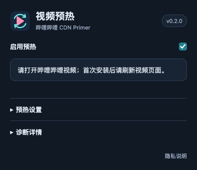

<p align="center"></p>
<h1 align="center">Bilibili CDN Primer</h1>
<p align="center">Controlled priming of upcoming Bilibili video segments for Firefox.</p>
<p align="center"><a href="README.zh-CN.md">简体中文</a> · English · <a href="PRIVACY.md">Privacy</a> · <a href="https://github.com/z11i/bilibili-cdn-primer/issues">Support</a></p>

Bilibili CDN Primer requests upcoming DASH video segments ahead of playback, then ends each request after a configurable deadline. It follows the video representation and CDN already selected by the player and adjusts its schedule when you seek, change playback speed, or switch streams.

## Features

- Moving look-ahead window based on playback position and buffered data.
- Exact segment byte ranges from the video’s SIDX index, including a bounded media-header fallback when page metadata is unavailable.
- Configurable request duration, byte limits, intervals, and look-ahead timing.
- One shared request slot and a rolling traffic budget across tabs.
- Automatic cancellation on seeks and stream changes, with priority given to a player running low on buffer.
- Simplified Chinese by default, English localization, and a manual language selector. Automatic mode uses the video page’s declared language when supported.
- Local status and diagnostic export.

Priming uses additional bandwidth. Its effect depends on CDN caching, the video service, and your network path. The extension does not switch the player’s CDN, change DNS, or retain media for playback. Current support covers video tracks in supported DASH on-demand streams; audio priming and live streams are outside its scope.

## Install for development

Requires desktop Firefox 142 or later.

1. Clone this repository or download and extract its source archive.
2. Open `about:debugging#/runtime/this-firefox` in Firefox.
3. Select **Load Temporary Add-on…**, then choose `extension/manifest.json`.
4. Reload a Bilibili video page and open the extension popup.

Temporary installations last until Firefox restarts. A package must be signed by Mozilla for normal installation. See [development and packaging](docs/development.md).

## Use

Enable priming from the popup. Open **Priming settings** to adjust the look-ahead window, timing, traffic limits, and language. This development build starts in Observe only mode, recording player downloads and stall intervals without sending priming requests. Limited priming defaults to 0.35 seconds, approximately 256 KiB per request, and a shared 8 MiB/minute budget. Player downloads take priority. See the [measurement procedure](docs/measurement.md) before comparing modes.

Optional **Adaptive priming** uses a byte target and a separate timeout, with bounded, session-only adjustments from later comparable player requests. Small idle-only recovery probes can run when buffer is low. See [adaptive mode](docs/adaptive.md) for limits and diagnostics.

CDN filters control when priming runs; they do not redirect the player. If the player has already buffered beyond the target window, no additional segment needs priming. Diagnostics distinguish partial, completed, and failed requests rather than assuming a cache is warm.

<p></p>

Select the mode from the dropdown; it is the single enable control. Version 0.4.2 adds per-tab scheduling and an opt-in bounded-concurrency setting for sustained blocking, with visible blockers and cooldown.

## Privacy

Requests go to the video’s existing supported CDN using Bilibili’s signed media URL, byte range, and page referrer. Browser cookies are omitted. Settings stay in local Firefox storage; recent diagnostic records stay in memory until explicitly exported to a local file. There are no advertising, analytics, or developer telemetry endpoints. Private browsing is not supported.

Read the [privacy policy](PRIVACY.md) and [permission explanations](docs/permissions.md).

## Development

Node.js 22+, npm, and Python 3 are needed for validation and packaging.

```sh
npm ci --ignore-scripts
npm run check
npm run build
```

The extension itself has no runtime dependencies or compilation step. `npm run check` runs unit tests and Mozilla’s extension validator. The build command creates an unsigned archive in `dist/`. Tests use synthetic media indexes and mocked browser/network APIs without contacting Bilibili.

## Support and contributions

Use [GitHub Issues](https://github.com/z11i/bilibili-cdn-primer/issues) for bug reports and suggestions. Include the extension version and browser version. Review diagnostic exports before sharing; they can reveal video identifiers and network details.

See [contribution guidelines](CONTRIBUTING.md). MIT licensed. This is an independent project and is not affiliated with Bilibili, Mozilla, or CDN providers.
